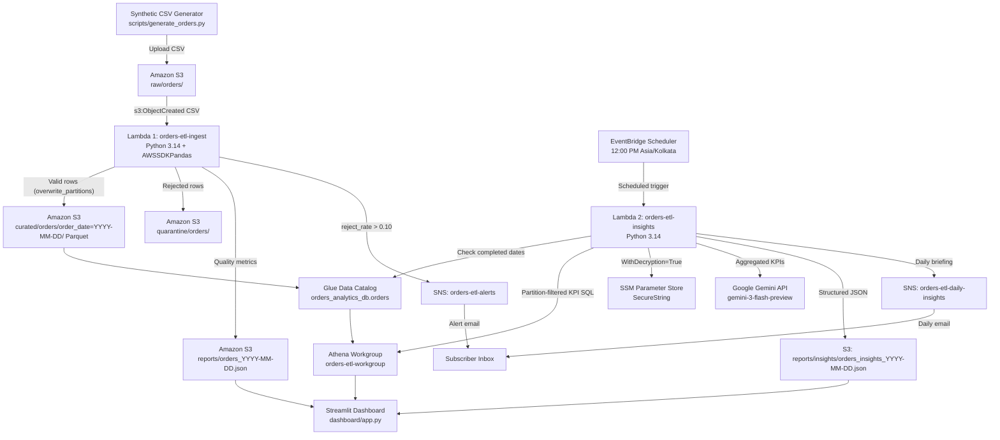
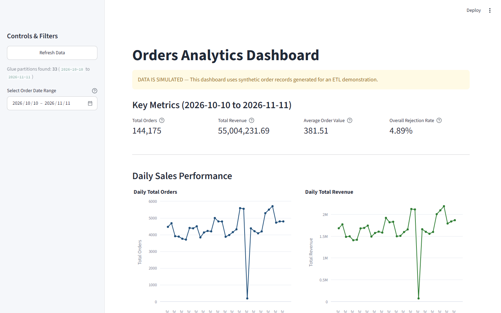
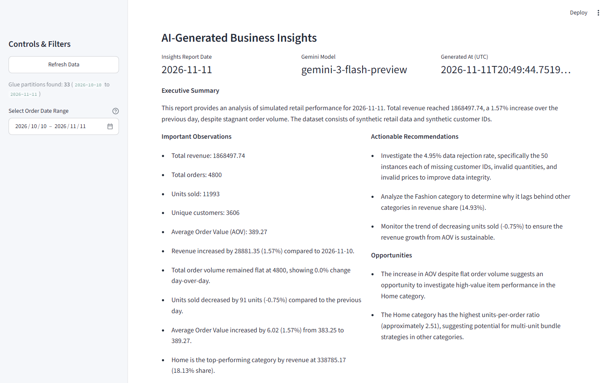

# Serverless Retail ETL Pipeline with Automated Data Quality, AI Insights & Interactive Dashboard

[](https://www.python.org/)
[](https://aws.amazon.com/)
[](https://ai.google.dev/)
[](https://streamlit.io/)
[](tests/)

> **Simulated Data Disclosure:** All CSV order files, customer IDs, quality audit reports, and AI-generated executive briefings in this project are produced from **synthetic retail data** generated by [`scripts/generate_orders.py`](scripts/generate_orders.py). They are for engineering demonstration and do not represent real customers or real financial transactions.

---

## Table of Contents

1. [What This Project Does (In Plain English)](#1-what-this-project-does-in-plain-english)
2. [Why This Architecture Matters](#2-why-this-architecture-matters)
3. [End-to-End Architecture](#3-end-to-end-architecture)
4. [Step-by-Step Lifecycle of One Daily Order File](#4-step-by-step-lifecycle-of-one-daily-order-file)
5. [Data Schema & Automated Quality Rules](#5-data-schema--automated-quality-rules)
6. [AI Business Insights (Athena + Gemini)](#6-ai-business-insights-athena--gemini)
7. [Interactive Analytics Dashboard (Local & Render)](#7-interactive-analytics-dashboard-local--render)
8. [Verified Metrics & Live AWS Results](#8-verified-metrics--live-aws-results)
9. [Project Folder Structure](#9-project-folder-structure)
10. [How to Run Locally & Deploy](#10-how-to-run-locally--deploy)
11. [Security, IAM & Cost Breakdown](#11-security-iam--cost-breakdown)
12. [Testing & Verification](#12-testing--verification)
13. [Known Limitations & Future Roadmap](#13-known-limitations--future-roadmap)

---

## 1. What This Project Does (In Plain English)

Imagine an online store that drops a daily spreadsheet (`orders_YYYY-MM-DD.csv`) of thousands of customer orders into cloud storage every day. Raw spreadsheets are messy: some rows are missing customer numbers, some have negative quantities or `$0` prices, and some orders appear twice.

Instead of letting bad data silently corrupt executive reports, this project builds a **fully automated, serverless sorting and reporting factory** on AWS:

1. **Automatic Gatekeeper (Ingest Lambda):** The moment a CSV lands in Amazon S3, AWS Lambda wakes up automatically, inspects every single row against 7 data-quality rules, and splits the file into:
   - **Clean analytics data** (converted to fast, columnar Parquet files partitioned by date)
   - **Quarantine file** (every rejected row saved with exact row numbers and failure reasons for debugging)
   - **Quality scorecard** (a JSON report summarizing total, valid, and rejected counts)
2. **Instant Quality Alarms (SNS Alerts):** If more than **10%** of a file fails validation, AWS SNS immediately emails an alert so engineers catch upstream breakages right away. On healthy days (~5% test defect rate), the pipeline stays quiet.
3. **SQL Analytics Warehouse Without Servers (Glue + Athena):** Clean Parquet files are cataloged in AWS Glue and queried directly with SQL in Amazon Athena—paying only for bytes scanned, with zero idle database servers.
4. **Daily AI Executive Briefing (Insights Lambda + Gemini + EventBridge):** Every day at **12:00 PM IST**, EventBridge triggers a second Lambda function. It computes verified KPIs and day-over-day comparisons in Athena, passes **only aggregated metrics** (never raw customer rows) to Google's Gemini API, saves a structured JSON briefing to S3, and emails the summary to stakeholders.
5. **Interactive Web Dashboard (Streamlit):** A clean analytics dashboard displays real Athena KPIs, interactive Plotly charts, data-quality coverage, and the latest Gemini executive briefing—running locally or safely on Render with 1-hour caching and an optional passcode gate.

---

## 2. Why This Architecture Matters

| Design Choice | Why We Chose It |
| --- | --- |
| **AWS Lambda + S3 Triggers** | Zero always-on servers; runs only when CSV files arrive (`~745 ms` per normal batch). |
| **Snappy Parquet partitioned by `order_date`** | Columnar compression cuts storage size and lets Athena skip unrelated dates when queries filter on `order_date`. |
| **Idempotent `overwrite_partitions`** | Re-uploading the same day's CSV replaces that date's Parquet partition instead of creating duplicate rows (`192` rows verified twice on `2026-11-01`). |
| **Two Separate SNS Topics** | Keeps noisy operational failures (`orders-etl-alerts`) separate from clean executive summaries (`orders-etl-daily-insights`). |
| **Python/SQL KPIs + Structured Gemini Output** | Athena calculates every metric deterministically first; Gemini only narrates verified aggregates using a strict JSON `responseSchema`, preventing hallucinated math. |
| **SSM `SecureString` for API Key** | The Gemini key never lives in code, Lambda env vars, Git, or logs—Lambda decrypts it on demand using AWS KMS. |
| **1-Hour Dashboard Cache (`ttl=3600`) + Passcode Gate** | Keeps live Athena queries under a `$5/month` budget even if hosted publicly on Render. |

---

## 3. End-to-End Architecture



*For component boundaries and IAM isolation details, see [`docs/ARCHITECTURE.md`](docs/ARCHITECTURE.md).*

---

## 4. Step-by-Step Lifecycle of One Daily Order File

1. **Generate or drop a CSV:** `orders_2026-11-11.csv` is uploaded to `s3://orders-etl-pipeline-2026-11-7f3a9c/raw/orders/`.
2. **S3 triggers Lambda 1:** S3 notification `OrdersCsvIngestTrigger` filters for `ObjectCreated:*` with prefix `raw/orders/` and suffix `.csv` and invokes `orders-etl-ingest`.
3. **Validate & split:** [`src/lambda_ingest/lambda_function.py`](src/lambda_ingest/lambda_function.py) checks required columns, strips whitespace, parses types/UTC timestamps, flags duplicates, writes valid rows to `curated/orders/order_date=2026-11-11/*.snappy.parquet`, writes bad rows to `quarantine/orders/orders_2026-11-11.csv`, and writes `reports/orders_2026-11-11.json`.
4. **Conditional Alert:** If `reject_rate > 0.10` (like our `19.23%` test file on `2026-11-12`), Lambda 1 publishes the JSON scorecard to `orders-etl-alerts` and emails the subscriber.
5. **Catalog & Query:** Glue table `orders_analytics_db.orders` maps the Parquet schema and `order_date` partitions so Athena queries (`orders-etl-workgroup`) scan only targeted date folders.
6. **Scheduled AI Briefing:** At `12:00 PM Asia/Kolkata`, EventBridge Scheduler (`orders-etl-daily-insights-schedule`) invokes `orders-etl-insights` with `{}`. Lambda 2 checks that yesterday's partition exists in Glue, runs 3 partition-filtered Athena queries, requests a structured JSON summary from `gemini-3-flash-preview`, saves `reports/insights/orders_insights_YYYY-MM-DD.json`, and emails the report via `orders-etl-daily-insights`.
7. **Visualize:** Opening the Streamlit dashboard discovers available Glue partitions, displays KPIs/charts, checks quality report coverage, and renders the latest AI briefing.

---

## 5. Data Schema & Automated Quality Rules

### Input CSV Columns
| Column | Expected Format | Validation Rule | Rejection Reason Key |
| --- | --- | --- | --- |
| `order_id` | Non-empty string | Must be non-blank; first occurrence kept per file | `missing_order_id`, `duplicate_order_id` |
| `customer_id` | Integer (e.g. `7172.0` or `7172`) | Numeric and whole integer (`mod 1 == 0`) | `missing_customer_id` |
| `category` | Non-empty string | Must be non-blank | `missing_category` |
| `quantity` | Positive integer | Finite, `> 0`, whole integer (`mod 1 == 0`) | `invalid_quantity` |
| `unit_price` | Positive number | Finite (rejects `inf`/`-inf`) and `> 0` | `invalid_unit_price` |
| `order_ts` | Timestamp string | Parseable UTC timestamp | `missing_order_ts` |

- **File-level failures** (missing required headers, 0-byte CSVs, header-only CSVs, malformed quotes) record a `"status": "failed"` JSON report under `reports/` without writing corrupted Parquet.
- **Overlapping reasons:** A single row can violate multiple rules (`reject_reason` joins them with `;`). In quality reports, `reason_counts` counts occurrences per rule independently, while `rejected_rows` counts unique bad rows.

<details>
<summary>Example Quality Report JSON (<code>reports/orders_2026-11-11.json</code>)</summary>

```json
{
  "status": "processed",
  "source_file": "orders_2026-11-11.csv",
  "total_rows": 5050,
  "valid_rows": 4800,
  "rejected_rows": 250,
  "reject_rate": 0.049505,
  "reason_counts": {
    "missing_order_id": 0,
    "missing_customer_id": 50,
    "invalid_quantity": 50,
    "invalid_unit_price": 50,
    "missing_order_ts": 50,
    "missing_category": 0,
    "duplicate_order_id": 50
  },
  "processed_at": "2026-11-11T19:55:39.657441+00:00"
}
```

</details>

---

## 6. AI Business Insights (Athena + Gemini)

Implemented in [`src/lambda_insights/lambda_function.py`](src/lambda_insights/lambda_function.py) (`orders-etl-insights`):

- **Safe Date Resolution:** Uses explicit `date` / `report_date` for manual runs, or automatically calculates **yesterday in `Asia/Kolkata`** when triggered by EventBridge `{}`.
- **Missing-Partition Guard:** Queries Glue `get_partitions` before touching Athena or Gemini. If a date partition is missing or empty, it logs a warning and returns `skipped_missing_partition`—never fabricating insights or sending misleading emails.
- **Aggregated-Only Input to Gemini:** Runs 3 partition-filtered Athena queries (KPIs + day-over-day comparison against the previous available partition, category breakdown, and top-10 simulated customer concentration) and sends only aggregated metrics to `gemini-3-flash-preview` (`https://generativelanguage.googleapis.com/v1beta/models/...:generateContent` via `x-goog-api-key`).
- **Structured Output Schema:** Enforces `responseMimeType: "application/json"` with required fields (`executive_summary`, `numerical_observations`, `revenue_and_order_trends`, `category_performance`, `customer_concentration`, `opportunities`, `recommendations`, `limitations_and_caveats`) and bounded retries on HTTP `429`/`5xx`.

---

## 7. Interactive Analytics Dashboard (Local & Render)

The Streamlit app ([`dashboard/app.py`](dashboard/app.py)) acts as a strictly read-only presentation layer:

- **Top Disclosure Banner:** Clearly states `DATA IS SIMULATED`.
- **Dynamic Sidebar Date Selector:** Discovers available `order_date` partitions from AWS Glue (`33` contiguous days: `2026-10-10` to `2026-11-11`) so users cannot query unregistered dates.
- **8 Dashboard Panels:**
  1. **KPI Cards:** Total Orders, Total Revenue, Average Order Value, and Overall Rejection Rate (`SUM(rejected_rows) / SUM(total_rows) * 100`—never a simple average of daily percentages).
  2. **Daily Sales Performance:** Interactive Plotly line charts for daily orders and daily revenue.
  3. **Revenue by Category:** Category revenue bar chart (`Electronics`, `Fashion`, `Beauty`, `Home`, `Books`, `Sports`).
  4. **Top 10 Customers by Revenue:** Horizontal bar chart labeled with synthetic IDs (`Sim ID ...`) since the dataset contains no product IDs or real PII.
  5. **Daily Data Quality Trend:** Daily rejection percentage over time from S3 quality JSONs.
  6. **Validation-Failure Occurrences by Reason:** Aggregated `reason_counts` labeled accurately as rule failure occurrences.
  7. **Quality Report Coverage:** Selected dates, reports found, missing reports, and row totals (with warnings if any date is missing or malformed).
  8. **AI-Generated Business Insights:** Reads `reports/insights/orders_insights_YYYY-MM-DD.json` from S3 with `Asia/Kolkata` completed-day freshness detection (`min(latest_partition_date, today_ist - 1 day)`), so having a `2026-11-12` test partition does not falsely mark the `2026-11-11` report as stale.




---

## 8. Verified Metrics & Live AWS Results

All figures below were independently verified against live AWS Athena, S3 objects, CloudWatch Logs, and local Parquet checks:

| Scope / Test | Input Rows | Valid / Orders | Rejected (Rate) | Total Revenue | AOV |
| --- | ---: | ---: | ---: | ---: | ---: |
| **Nov 10 Baseline (`2026-11-10`)** | `5,050` | `4,800` | `250` (`4.9505%`) | `1,839,616.39` | `383.25` |
| **Nov 11 Baseline (`2026-11-11`)** | `5,050` | `4,800` | `250` (`4.9505%`) | `1,868,497.74` | `389.27` |
| **Nov 1 Idempotency Re-upload (`2026-11-01`)** | `202` | `192` | `10` (`4.9505%`) | — | — |
| **Nov 12 High-Rejection Alert (`2026-11-12`)** | `1,040` | `840` | `200` (`19.2308%`) | — | — |
| **Full 33-Day Span (`2026-10-10`–`2026-11-11`)** | `151,590` | `144,175` | `7,415` (`4.8915%`) | `55,004,231.69` | `381.51` |

- **SNS Alerts & Daily Emails:** Both `orders-etl-alerts` (`2026-11-12` high-defect email) and `orders-etl-daily-insights` (`2026-11-11` AI insights email) were confirmed received in the subscribed inbox.
- **EventBridge Schedule:** `orders-etl-daily-insights-schedule` is `ENABLED` (`cron(0 12 * * ? *)`, `Asia/Kolkata`, targeting `orders-etl-insights` with `{}`). Manual `{}` execution succeeded; live 12:00 PM IST automated firing has not yet occurred.

---

## 9. Project Folder Structure

```text
├── .env.example                 # Non-secret environment template (+ commented Render vars)
├── .gitignore                   # Excludes .env, .venv, ZIPs, CSVs, Parquet, __pycache__
├── render.yaml                  # Render Web Service Blueprint (1h cache + passcode gate)
├── requirements.txt             # Root dev/test/AWS verification dependencies
├── dashboard/
│   ├── app.py                   # Streamlit UI (8 panels + optional passcode gate)
│   ├── athena.py                # Dual auth (local AWS CLI profile / Render env vars) + Athena client
│   ├── quality.py               # Paginated S3 quality JSON aggregator
│   ├── insights.py              # S3 AI insights loader + IST completed-day freshness checks
│   └── requirements.txt         # Dashboard runtime dependencies (includes boto3[crt])
├── docs/
│   ├── ARCHITECTURE.md          # Detailed system boundaries & Mermaid diagram
│   ├── COST_ESTIMATE.md         # Resource inventory & $5 budget analysis
│   ├── DASHBOARD_BUILD_REPORT.md
│   ├── DEPLOYMENT_GUIDE.md      # Full AWS + SSM + Scheduler + Render setup guide
│   ├── FINAL_PROJECT_REPORT.md  # Complete handover & verification report
│   ├── PROJECT_GUIDE.md         # Schema, validation rules & operations handbook
│   ├── TEST_REPORT.md           # Unit + live AWS test evidence
│   ├── screenshots/             # Real captured dashboard screenshots
│   └── *.json                   # Least-privilege IAM policies, Glue/Athena/S3 configs
├── scripts/
│   └── generate_orders.py       # Configurable synthetic order CSV generator
├── sql/
│   ├── 01_validate_orders.sql
│   ├── 02_daily_kpis.sql
│   └── 03_multi_day_kpis.sql
├── src/
│   ├── lambda_ingest/lambda_function.py    # Lambda 1: CSV validation, Parquet, quarantine, SNS alerts
│   └── lambda_insights/lambda_function.py  # Lambda 2: Athena KPIs, SSM, Gemini insights, daily email
└── tests/
    ├── test_dashboard.py
    ├── test_lambda_ingest.py
    └── test_lambda_insights.py
```

---

## 10. How to Run Locally & Deploy

### A. Run the Dashboard Locally
1. Copy the template environment file (never commit `.env`):
   ```powershell
   Copy-Item .env.example .env
   ```
2. Ensure your AWS CLI profile (`etl-project` in `ap-southeast-2`) is authenticated (e.g., via `aws login` / browser login—no static IAM access keys needed locally).
3. Activate `.venv`, install dashboard dependencies, and launch Streamlit:
   ```powershell
   .\.venv\Scripts\Activate.ps1
   pip install -r dashboard/requirements.txt
   streamlit run dashboard/app.py
   ```
   Open **`http://localhost:8501`**.

### B. Generate & Ingest New Synthetic Data
```powershell
# Generate 5,000 normal rows (~4.95% reject rate) or high-defect rows (--defect-rate 0.04 -> ~19.23%)
.\.venv\Scripts\python.exe .\scripts\generate_orders.py 2026-11-13 --rows 5000 --defect-rate 0.01

# Upload to raw/orders/ (automatically triggers Lambda 1)
aws --no-cli-pager s3 cp .\data\orders_2026-11-13.csv s3://orders-etl-pipeline-2026-11-7f3a9c/raw/orders/ --profile etl-project --region ap-southeast-2

# Register the new partition in Glue/Athena before querying
# MSCK REPAIR TABLE orders_analytics_db.orders;
```

### C. Deploy Safely to Render (Web Hosting)
The dashboard includes [`render.yaml`](render.yaml) and [`docs/render_readonly_policy.json`](docs/render_readonly_policy.json):
1. Connect this GitHub repository in Render using the **`render.yaml`** Blueprint.
2. In AWS IAM, create a dedicated read-only credential attached **only** to [`docs/render_readonly_policy.json`](docs/render_readonly_policy.json).
3. In **Render Dashboard → Environment**, set the 3 secret variables:
   - `AWS_ACCESS_KEY_ID`
   - `AWS_SECRET_ACCESS_KEY`
   - `DASHBOARD_PASSCODE` *(protects Athena/S3 from public traffic)*
4. `render.yaml` automatically sets `AWS_PROFILE=""`, `DASHBOARD_CACHE_TTL_SECONDS="3600"` (1-hour cache), and health check `/_stcore/health`.

*Full deployment & operations guide: [`docs/DEPLOYMENT_GUIDE.md`](docs/DEPLOYMENT_GUIDE.md) | Render step-by-step: [`docs/RENDER_DEPLOYMENT_GUIDE.md`](docs/RENDER_DEPLOYMENT_GUIDE.md) | Developer guide: [`docs/PROJECT_GUIDE.md`](docs/PROJECT_GUIDE.md)*

---

## 11. Security, IAM & Cost Breakdown

- **No Static Keys in Code or Repo:** Local CLI uses browser-based authentication (`aws iam list-users` = `[]`), `.env` is excluded by [`.gitignore`](.gitignore), and `GEMINI_API_KEY` is stored encrypted in AWS SSM Parameter Store (`/orders-etl/gemini-api-key`, `SecureString` via `alias/aws/ssm`).
- **Least-Privilege Roles:** Separate IAM roles for ingestion (`orders-etl-lambda-ingest-role`), AI insights (`orders-etl-insights-role`), and scheduler (`orders-etl-scheduler-role`).
- **Private & Encrypted S3:** `orders-etl-pipeline-2026-11-7f3a9c` (`324` objects, `13.94 MiB`) has all 4 Block Public Access settings enabled and `AES256` default encryption.
- **Cost Control (`$5.00/month` Budget):** No always-running EC2, RDS, or NAT Gateways. Steady-state monthly cost is estimated at **~$0.02 – $0.10 USD/month** ([`docs/COST_ESTIMATE.md`](docs/COST_ESTIMATE.md)), guarded by Athena's `100 MiB` per-query cutoff, mandatory `order_date` filters, 1-hour dashboard caching, and the optional passcode gate.

---

## 12. Testing & Verification

Run all **31 automated unit tests** offline (mocked AWS & Gemini clients):
```powershell
.\.venv\Scripts\python.exe -m unittest discover -s tests -v
```
- `tests/test_lambda_ingest.py` (`13` tests): schema validation, malformed/empty CSVs, infinite/negative values, duplicate `order_id`s, multi-record events, SNS threshold & error logging.
- `tests/test_lambda_insights.py` (`6` tests): `Asia/Kolkata` yesterday date resolution, Athena errors/timeouts, Gemini structured JSON / HTTP `429` retry / malformed handling, missing partition skips, and S3/SNS flow.
- `tests/test_dashboard.py` (`12` tests): Render vs local auth priority, 1-hour TTL check, partition-filter SQL guard, pagination, missing/malformed/stale report handling, and the `2026-11-12` partition freshness regression test.

*Full evidence logs, QueryExecutionIds, and Playwright browser results are recorded in [`docs/TEST_REPORT.md`](docs/TEST_REPORT.md).*

---

## 13. Known Limitations & Future Roadmap

- **Per-file deduplication:** `duplicate_order_id` checks within each CSV file, not across historical days.
- **Zero-valid-row reprocessing:** If a reprocessed file contains zero valid rows, Parquet writing is skipped rather than deleting the old partition.
- **Manual Glue partition discovery:** Lambda 1 writes Parquet without calling `glue:CreatePartition`; new date folders require `MSCK REPAIR TABLE` or `ALTER TABLE ADD PARTITION` before Athena sees them.
- **Scheduled execution observation:** `orders-etl-daily-insights-schedule` is verified `ENABLED` for `12:00 PM IST`, and manual `{}` invocation passed, though its first live time-triggered fire is pending the next `12:00 PM IST` window (and returns `skipped_missing_partition` on days with no uploaded CSV).
- **SQS / DLQ Hardening:** Intentionally deferred to keep architecture and costs minimal for this workload; can be added cleanly between S3 and `orders-etl-ingest` later.

---

## Further Documentation

- [`docs/FINAL_PROJECT_REPORT.md`](docs/FINAL_PROJECT_REPORT.md) — Executive summary, resource inventory, and handover report
- [`docs/PROJECT_GUIDE.md`](docs/PROJECT_GUIDE.md) — Developer operations and SQL guide
- [`docs/DEPLOYMENT_GUIDE.md`](docs/DEPLOYMENT_GUIDE.md) — Step-by-step AWS & Render setup
- [`docs/RENDER_DEPLOYMENT_GUIDE.md`](docs/RENDER_DEPLOYMENT_GUIDE.md) — Detailed Render hosting walkthrough & IAM key setup
- [`docs/DASHBOARD_BUILD_REPORT.md`](docs/DASHBOARD_BUILD_REPORT.md) — Dashboard architecture and verification
- [`docs/COST_ESTIMATE.md`](docs/COST_ESTIMATE.md) — Detailed AWS & Gemini pricing audit
