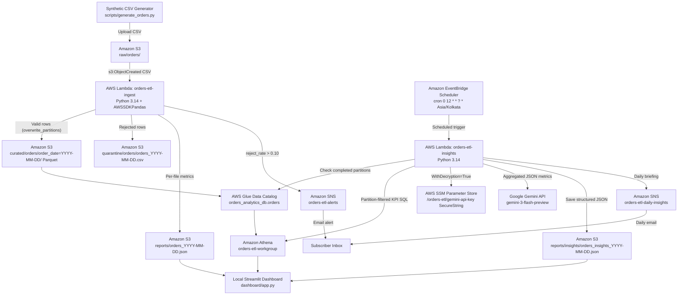

# Architecture — Serverless AWS ETL Pipeline

> **Simulated Data Disclosure:** All orders, customer identifiers, quality reports, and AI insights are produced from synthetic retail datasets generated by [`scripts/generate_orders.py`](../scripts/generate_orders.py).

## End-to-End Architecture

## Component Design & Boundaries

1. **Ingestion & Automated Quality Gate (`orders-etl-ingest`)**
   - Triggered automatically by S3 `ObjectCreated:*` events matching `raw/orders/*.csv` (`OrdersCsvIngestTrigger`).
   - Validates schema, types, positive quantities/prices (rejecting non-finite values), timestamps, and per-file `order_id` uniqueness.
   - Writes valid records as Snappy-compressed Parquet partitioned by `order_date` (`mode="overwrite_partitions"`), quarantines bad rows with `source_row_number` and semicolon-joined `reject_reason`, and writes `reports/orders_YYYY-MM-DD.json`.
   - Publishes an alert to `orders-etl-alerts` strictly when `reject_rate > REJECT_RATE_THRESHOLD` (`0.10`).

2. **Catalog & Serverless Analytics (`orders_analytics_db.orders` / `orders-etl-workgroup`)**
   - Glue External Table pointing to `s3://orders-etl-pipeline-2026-11-7f3a9c/curated/orders/` with `order_date` partition key.
   - Athena workgroup enforces `SSE_S3` encryption, output prefix `athena-results/`, and a `100 MiB` (`104,857,600` bytes) per-query scan cutoff.

3. **Scheduled AI Business Insights (`orders-etl-insights`)**
   - Invoked daily at **12:00 PM IST (`Asia/Kolkata`)** via EventBridge Scheduler (`orders-etl-daily-insights-schedule`) using a dedicated `orders-etl-scheduler-role`.
   - Resolves the previous completed calendar day in `Asia/Kolkata` (`report_date`) unless explicitly overridden in test payloads.
   - Checks Glue partitions first; if the target partition is missing or empty, logs and returns `skipped_missing_partition` / `skipped_no_data` without fabricating insights or emailing.
   - Computes authoritative KPIs, day-over-day comparison, category shares, and top-10 customer concentration metrics in Athena/Python before passing **aggregated-only** data to Google Gemini (`gemini-3-flash-preview`) using `responseMimeType: "application/json"` and an explicit `responseSchema`.
   - Retrieves `GEMINI_API_KEY` from SSM `SecureString` `/orders-etl/gemini-api-key` via KMS `alias/aws/ssm` and never logs credentials.
   - Saves structured JSON to `reports/insights/orders_insights_YYYY-MM-DD.json` and emails the daily summary via `orders-etl-daily-insights`.

4. **Read-Only Local Presentation Layer (`dashboard/`)**
   - Runs strictly locally (`http://localhost:8501`) via `boto3.Session` with the `etl-project` CLI profile (`ap-southeast-2`).
   - Discovers date bounds dynamically from Glue `get_partitions`, runs partition-filtered Athena queries, aggregates S3 quality reports (`SUM(rejected_rows) / SUM(total_rows) * 100`), and reads the latest `reports/insights/orders_insights_YYYY-MM-DD.json` with IST completed-day freshness checks and 300-second caching (`@st.cache_data`).

5. **Deferred Hardening (SQS / DLQ)**
   - S3 → SQS → Lambda with a Dead-Letter Queue (`maxReceiveCount = 3`) is intentionally deferred to keep cost and operational complexity minimal for the current portfolio workload while preserving clean direct S3-to-Lambda ingestion.
